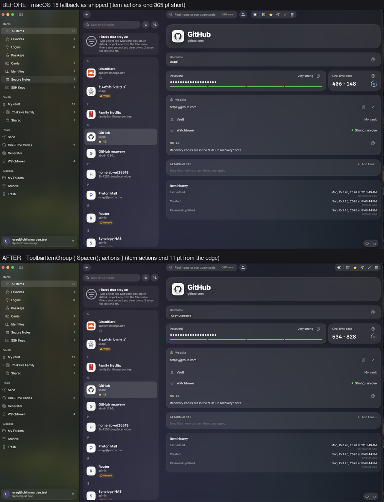
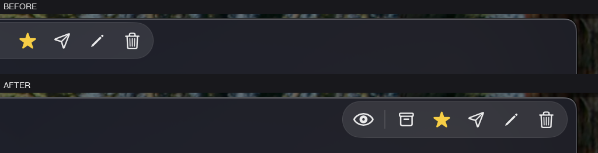

# macOS 15 compatibility feasibility note

Date: 2026-10-26. Replaces the note of 2026-10-10.

Issue: [#112](https://github.com/sinhong2011/triwarden/issues/112). Parent: [#105](https://github.com/sinhong2011/triwarden/issues/105).

## Purpose and scope

This note answers one question. Can Triwarden lower the official minimum from macOS 26 to macOS 15 (Sequoia)?
It covers the API surface, the product surfaces, the build and CI options, and the release process.

This note now includes macOS 15 runtime evidence. A Sequoia 15.6.1 VM ran the build.
Section 8 lists what the run proved and what it did not prove.

## Conclusion

**Recommendation: no-go, unless macOS 15 becomes a product goal.**

The runtime evidence is strong. The fallback build ran on macOS 15.6.1 without a crash. It signed in
to a live server, synced, and unlocked from the cache. Most features work. Section 8 gives the evidence.

The cost is not in the code. It is in the visual work. The toolbar fallback compiles and runs, but its
layout is wrong in three ways that no compiler or test reports. See section 1. Each macOS 26 API you
use from now on needs a second design, and a person must look at it on an older Mac. That is a
standing cost on a project whose target is macOS 26.

Decide by product need, not by technical feasibility:

- **If macOS 15 users are a goal:** do the toolbar work first. Then add the `macos-15` CI job, then
  test the signed surfaces. Keep the public minimum at 26 until all of that passes.
- **If macOS 26 stays the target:** stop here. Keep this note as a record. Do not merge the fallback
  branches, because they add a second layout path that nobody will maintain or test.

The one thing not to do is merge the fallbacks and lower the deployment target while the layout is
wrong. That ships a broken header to every Sequoia user.

Section 7 gives the go/no-go criteria.

## Test method and environment

Compile-time checks:

- Host: macOS 27.0.1. Xcode 27.1 (27A9275). SDK macOS 27.0.
- Base commit: `b768927`. The fallback code was uncommitted work in the worktree.
- Method: copy the tracked tree. Lower both minimums to 15. Build. Record every error.

Runtime checks:

- Guest: UTM virtual machine, macOS 15.6.1 (24G90), arm64, 98 GB free.
- Build: Debug, arm64, `MACOSX_DEPLOYMENT_TARGET=15.0`, unsigned.
- Transfer: `scp` of the 75 MB app bundle. The VirtioFS share was not available. See section 8.
- The guest ran the app, its self-test, and its snapshot renderer. The guest has no Xcode.

The build uses the current SDK. It does not use an older SDK. The deployment target is the only change.

## 1. macOS 26 API surface

The compiler found three API uses that need macOS 26. All three are in `App/Sources/VaultView.swift`:

| Line | API | Fallback needed |
| --- | --- | --- |
| 309 | `sharedBackgroundVisibility(.hidden)` on the header toolbar item | Yes |
| 2954 | `ToolbarSpacer(.flexible)` | Yes |
| 2957 | `sharedBackgroundVisibility(.hidden)` on the item actions toolbar item | Yes |

`sharedBackgroundVisibility` applies to `ToolbarContent` only. You cannot put it in a `ViewModifier`.
The fallback must branch inside the `.toolbar { }` builder. The compiler rejects the modifier form.

This note tested one fallback design:

- Header item: duplicate the `ToolbarItem` in an `if #available(macOS 26.0, *)` / `else` pair.
  The macOS 26 branch adds `.sharedBackgroundVisibility(.hidden)`. The other branch does not.
- Item actions: the macOS 26 branch keeps `ToolbarSpacer(.flexible)` and hides the shared background.
  The other branch uses `ToolbarItem(placement: .primaryAction) { actions }`.

This design compiles for Debug, Release, and universal Release. It is an experiment, not a finished design.

### The macOS 15 layout is wrong

The fallback builds and runs, but its layout does not match macOS 26. A live window on the guest
shows two differences:

1. **No top gap.** The toolbar starts at the window's top edge. The controls sit at y=51 in a window
   that starts at y=48. On macOS 26 the header floats below a gap.
2. **The item actions do not reach the right edge.** The action group ends 365 points before the
   window's right edge. Without `ToolbarSpacer(.flexible)`, `placement: .primaryAction` does not
   push the group to the trailing edge.

**Correction 1.** An earlier draft reported the toolbar layout as "Pass. Item actions sit at the
trailing edge." That was wrong. The test used the app's `--snapshot` mode, which does not draw the
real toolbar chrome. Measure the layout in a live window, not from a snapshot render.

**Correction 2.** A later draft listed a third difference: "A tinted bar remains across the top."
That was also wrong. Two live windows, measured at the same size, show the toolbar background and
the content background differ by 1 to 2 colour levels out of 255. That is one surface, not two.
The toolbar has no separate background to clear. `.toolbarBackgroundVisibility(.hidden, for:
.windowToolbar)` already does its job on macOS 15.

The tinted-bar claim came from looking at a screenshot, not from measuring pixels. A dark toolbar
looks tinted next to a light sidebar. Compare the toolbar colour with the content colour directly
before you report a background defect.

### Fix for difference 2

A flexible spacer in the same toolbar group moves the group to the trailing edge:

```swift
} else {
    ToolbarItemGroup(placement: .primaryAction) {
        Spacer()
        actions
    }
}
```

Measured in a live window at 1617 points wide: the gap falls from 365 points to 11 points.
The 11 points match the window's own trailing inset, so the group now sits at the edge.





Both windows are 1617 by 1006 points. The only difference between them is the toolbar code above.
The screenshots come from a Debug build with `MACOSX_DEPLOYMENT_TARGET=15.0` and
`CODE_SIGNING_ALLOWED=NO`, on a macOS 15.6.1 guest.

This changes the cost of the fallback. The code is small, but each fallback needs its own visual
check on the older system. Compiling and passing tests is not sufficient.

### Difference 1 has no fix without a redesign

`ToolbarSpacer(.flexible)` is the only way to make the macOS 26 header float. macOS 15 has no
equivalent. Difference 1 stays unless the header moves out of the toolbar on both systems.

### Correction to the earlier note

The note of 2026-10-10 reported a "SwiftUI type-check timeout" as a separate problem.
That is not correct. The timeout is a side effect of the unavailable symbols.
When the availability branches are correct, the timeout does not occur. This work needs no extra step.

### APIs that are already available on macOS 15

The compiler reports every symbol that is newer than the deployment target. After the three branches
from the table above, the compiler reports no more. So no other SwiftUI call in the app, the AutoFill
extension, or the shared code needs a change.

The audit also checked the main calls by name:

| API | Minimum |
| --- | --- |
| `toolbar(removing:)` | macOS 14 |
| `toolbarBackgroundVisibility(_:for:)` | macOS 15 |
| `containerBackground(for:)` | macOS 14 |
| `windowResizability(_:)` | macOS 13 |
| `restorationBehavior(_:)` | macOS 15 |
| `defaultLaunchBehavior(_:)` | macOS 15 |
| `onScrollGeometryChange` | macOS 15 |
| `onScrollPhaseChange` | macOS 15 |
| `scrollPosition(_:)` with `ScrollPosition` | macOS 15 |
| `onGeometryChange(for:of:action:)` | macOS 15 |

The app does not use `glassEffect`, `GlassEffectContainer`, `safeAreaBar`, or `backgroundExtensionEffect`.
The app does not use `WebView`.

The code base has no `@available` declarations today. The new branches will be the first.

## 2. Capabilities that need no change

The audit checked the system frameworks against the macOS 15 SDK headers and the system symbol database.

- **AutoFill, one-time codes:** `ASOneTimeCodeCredential`, `ASOneTimeCodeCredentialIdentity`,
  `ASOneTimeCodeCredentialRequest`, and `prepareOneTimeCodeCredentialList` are macOS 15.0.
- **AutoFill, passkeys:** the passkey entry points are macOS 14.0.
  `performPasskeyRegistrationWithoutUserInteractionIfPossible` is macOS 15.0.
- **AutoFill, settings:** `ASSettingsHelper` is macOS 14.0.
- **Touch ID:** `LAAuthenticationView` is macOS 12.0.
- **QR scanner:** `SCContentSharingPicker` is macOS 14.0.
- **Launch at login:** `SMAppService` is macOS 13.0.
- **SF Symbols:** the app uses 79 symbol names. All 79 are available at or before macOS 15.
  The audit checked each name against the system `name_availability.plist`.
- **Dynamic symbols:** the app has no weak-linked macOS 26 symbols and no runtime lookup of one.
  The one private selector, `_statusItems`, is guarded with `responds(to:)`.

No capability must be removed to target macOS 15.

## 3. Product surfaces to test on Sequoia

A claim of support needs evidence for each surface below.
The "CI" column shows whether a `macos-15` runner can cover the item without a person.
The "VM" column shows the result of the 2026-10-26 run in section 8.

| Surface | CI | VM | What must pass |
| --- | --- | --- | --- |
| Launch and first run | Yes | Pass | Window opens. Menu bar item appears. No crash. |
| Sign in and sync | Yes | Pass | Sign in. Initial sync. Incremental sync. Offline error path. |
| Unlock and lock | Partly | Pass | Master password unlock. Auto-lock. Keychain persistence across a relaunch. |
| Touch ID unlock | No | Not run | Enrolment prompt. Unlock. Fallback to password. |
| Item work | Yes | Pass | Create, edit, delete, search, Command Palette. |
| Clipboard | Partly | Not run | Copy. Expiry timer. Clear. |
| AutoFill, password | No | Blocked | Enable in System Settings. Fill. Save. |
| AutoFill, one-time code | No | Blocked | Fill a code from an item. |
| AutoFill, passkey | No | Blocked | Register and sign in with a passkey. |
| Safari extension | No | Blocked | Enable. Fill. Save. |
| Auto-Type helper | No | Pass | Grant Accessibility. Type into another app. |
| SSH agent | No | Pass | Approval card. Signature by `ssh`. |
| Updates | No | Partial | Sparkle loads. No update ran. |
| Appearance | Partly | Fail | Light and dark. Narrow window. No top gap on the toolbar. See section 1. |
| Upgrade path | No | Not run | Install a 26 build, then update to a 15 build. Confirm settings and vault survive. |

"Blocked" means an unsigned build cannot test the surface. Section 8 gives the cause.

The last row matters. A user on macOS 26 will receive a build with a lower minimum.
That direction is safe, but test it once.

## 4. Build and CI

### What compiles today

The audit lowered `project.yml` to `macOS: "15.0"` and `Packages/VaultCore/Package.swift` to `.macOS(.v15)`.
It applied the fallback from section 1. Results:

| Build | Result |
| --- | --- |
| Debug, arm64 | BUILD SUCCEEDED |
| Release, arm64 | BUILD SUCCEEDED |
| Release, arm64 + x86_64 | BUILD SUCCEEDED |
| `swift build` and `swift test` in VaultCore | 19 tests pass |

Every bundle reports `LSMinimumSystemVersion` 15.0:
the app, the AutoFill extension, the Safari extension, the Auto-Type helper, the `tw` tool, and the TriCrypto bundle.
The main binary reports `minos 15.0` for both architectures. Sparkle reports 12.0 and needs no change.

### A Sequoia runner exists

The earlier note said CI only runs on macOS 26. That is no longer a limit.
GitHub hosts a `macos-15` arm64 image. The image runs macOS 15.7.9 and includes Xcode 26.0.1 to 26.3.
The project needs Swift 6.2, and Xcode 26.x supplies it.

So the project can run real Sequoia jobs. Add one job to `.github/workflows/ci.yml`:

- `runs-on: macos-15`
- Select Xcode 26.3 with `xcode-select`.
- Run the existing steps: build, `IconStoreTests`, the compatibility self-test, and `CISmokeTests`.
- Run the Vaultwarden integration tests.

This covers most of section 3 automatically and costs no person-hours per release.

### What CI cannot cover

The runner is ephemeral and unsigned. These items stay manual:

- AutoFill, Safari extension, and Auto-Type need a signed build and a user session in System Settings.
- Touch ID needs enrolled hardware.
- The Sparkle update needs a published release.

## 5. Release process

Do not gate every publish on a human Sequoia tester. That adds a person to each release and it will stall.

Use this split:

- **Automatic gate, every release:** the `macos-15` CI job must pass. This is not optional.
- **Manual gate, once:** a person runs the section 3 list on a real Sequoia Mac before the first release that claims 15.
- **Manual check, best effort:** after that, the [#105](https://github.com/sinhong2011/triwarden/issues/105) requester
  tests each release that changes the minimum, the toolbar, or AutoFill. Treat a report as a bug report, not a veto.

### Release files that hard-code macOS 26

These must change in the same change that lowers the minimum. Until then they stay correct.

| File | Current value | Needed value |
| --- | --- | --- |
| `scripts/release.sh:129` | `depends_on macos: :tahoe` | `depends_on macos: :sequoia` |
| `README.md` lines 9, 15, 29 | macOS 26 | macOS 15 |
| `site/messages/*.json` (9 locales, 3 keys each) | macOS 26 | macOS 15 |
| `site/src/components/Home.astro:40` | `macOS 26 or later` | `macOS 15 or later` |
| `site/src/components/guide/SshGuide.astro:30` | `macOS 26 or later` | `macOS 15 or later` |

The Homebrew cask is the most important row. With `:tahoe`, `brew` refuses to install on Sequoia.
The user sees an error before the app ever starts.

Sparkle needs no change. `generate_appcast` reads `LSMinimumSystemVersion` from the built app
and writes `sparkle:minimumSystemVersion` into the appcast. A correct build produces a correct appcast.

## 6. Risks

1. **Toolbar layout on Sequoia.** Partly broken. A live window shows no top gap, and the item actions
   sit 365 points short of the right edge. A flexible spacer in the group closes the second defect
   (365 points to 11). The top gap has no fix without a redesign. See sections 1 and 8.
2. **App icon at large sizes.** `AppIcon.icns` has four representations: 16x16, 16@2x, 128x128, and 128@2x.
   It has no 32, 256, 512, or 1024 representation. This is not a defect on macOS 15.
   A check on the Sequoia guest asked `NSWorkspace` for the app icon. It returned a 2048-pixel
   representation and rendered at 1024x1024. macOS 15 reads the icon from `Assets.car`, which is complete.
   The `.icns` gap is real, but macOS 15 does not depend on it. See section 8.
3. **Extension activation.** Not yet tested. The AutoFill and Safari extensions need a signed build.
   System Settings paths and prompts differ between macOS versions. See section 8.
4. **A second minimum to maintain.** You must check every new API against 15 from now on.
   The `macos-15` CI job makes a mistake fail the build, which limits this risk.
5. **Unsigned builds cannot register extensions.** An ad-hoc signature strips the entitlements that
   `pluginkit` needs. This limits what a local QA build can prove. It is not a macOS 15 defect.
6. **Unsigned builds cannot use the App Group keychain.** Without `keychain-access-groups`, the
   data-protection keychain returns `errSecMissingEntitlement` (-34018). Refresh-token storage, session
   resume, and the AutoFill passkey write all fail. A Developer ID build carries the entitlement.
   This is the largest gap in the VM evidence, and it needs a signed build to close. See section 8.

## 7. Recommendation and go/no-go criteria

**No-go, unless macOS 15 becomes a product goal.** The steps below apply only if it does.

### Stage 1: fix the layout, then code and CI

1. **Fix the toolbar on macOS 15 first.** Push the item actions to the right edge. Section 1 gives a
   working fix. The top gap needs a design decision, because macOS 15 has no equivalent of
   `ToolbarSpacer(.flexible)`. Do not continue until a live window on Sequoia is acceptable.
2. Lower `project.yml` and `Packages/VaultCore/Package.swift` to 15.
3. Add the `macos-15` CI job from section 4.
4. Keep README, the site, and the cask at macOS 26.

**Go to stage 2 when:** the layout matches on a live Sequoia window, and the `macos-15` job passes on
`main` for three consecutive runs.

### Stage 2: signed build checks

Build, sign, and notarize a release candidate. Test the surfaces that an unsigned build cannot reach:

- AutoFill fills a password and a one-time code.
- The Safari extension fills a login.
- Touch ID and PIN unlock on a Mac with enrolled biometrics.
- The app icon is sharp in the Dock.
- The upgrade path from a 26 build.

**Go to stage 3 when** these pass with no crash.

The VM run already passed these: launch, no crash, window and menu bar item, offline self-test,
light and dark render, Sparkle load, and the account lifecycle against a live server.
Sign in, sync, unlock from cache, item work, organizations, passkeys, the SSH agent, the `tw` CLI,
browser fill, and two accounts all work on macOS 15. The toolbar layout does not. See section 8.

### Stage 3: public claim

Change README, the site in all locales, and the cask to macOS 15. Release.

**Stop and keep the minimum at 26 if** any of these occur:

- A crash on launch, unlock, or sync that has no quick fix.
- AutoFill cannot be enabled on Sequoia.
- The Safari extension does not load.
- The toolbar layout is broken and the fallback has no simple alternative.

### What this note does not prove

- Intel runtime behaviour. The universal build compiles, but no one ran it on Intel.
- The signed and notarized release on macOS 15.
- The updater on macOS 15. The Sparkle framework loads, but no update ran.
- Extension activation. An unsigned build cannot register the extensions. See section 8.
- Touch ID and PIN unlock. The VM has no enrolled biometrics. See section 8.
- Keychain persistence. An unsigned build has no keychain entitlement. See section 8.

## 8. macOS 15 runtime results

Date: 2026-10-26. Guest: macOS 15.6.1 (24G90), arm64, UTM.

### What passed

| Check | Result |
| --- | --- |
| App launches | Pass. Process starts and stays up. |
| No crash | Pass. No crash report. Main thread active after 44 seconds. |
| Window and menu bar item | Pass. Main window 1369x994 on screen, alpha 1.0. Menu bar item present. |
| Offline compatibility self-test | Pass. 24 checks, 0 failures. |
| UI render, light | Pass. 27 screens render. |
| UI render, dark | Pass. 25 screens render. |
| Toolbar fallback layout | Fail. No top gap. Actions short of the right edge; a spacer in the group fixes that. |
| App icon | Pass. `NSWorkspace` returns a 2048 px representation and renders at 1024x1024. |
| `tw` CLI | Pass. `--help` prints the command list. |
| Auto-Type helper | Pass. Binary starts and stays resident. |
| Sparkle loads | Pass. Framework and both XPC services load. Minimum 12.0. |
| Memory | 205 MB resident with the demo vault. |
| Sign in and sync, live server | Pass. 12 items from a Vaultwarden 1.35.0 server. |
| Item work, live server | Pass. Create, edit, archive, trash, restore, delete, clone, bulk actions. |
| Organizations and collections | Pass. Org key, shared collection, read-only refusal, collection filters. |
| SSH agent | Pass. `ssh-add` lists the key, signing asks once, a denied approval fails. |
| Passkeys in the vault | Pass. Save, sync, and sign with a passkey. |
| `tw` CLI against the server | Pass. Status, get, field, code, generate, refusal. |
| Browser fill and save | Pass. Suggestions scoped to the site, fill after approval. |
| App Intents | Pass. Generate, find, get a code. |
| Second account | Pass. Merged list, per-account lock, scoped restore. |

The self-test covers the shared decoder and the app's mutation boundaries.
It is the same test that CI runs with `--selftest-compatibility`.

The UI render uses the app's own `--snapshot` mode. That mode draws SwiftUI views directly to an image.
It does not use the window server. This was necessary because the VM does not composite windows into a
screen capture. A control test with System Settings showed the same blank capture. The cause is the VM
display, not Triwarden.

The snapshot images show the full vault window: sidebar, item list, item detail, one-time code, passkey row,
watchtower row, attachments, and the toolbar.

The same `--snapshot` run on the host gave a reference image. The host runs macOS 27.0.1, so this is not a
clean macOS 26 against macOS 15 pair. The section order and the spacing match. The images are not
byte-identical for two reasons that do not come from the deployment target:

- The host render shows cached site icons. The guest render shows letter placeholders.
- The host image is 28 pixels taller. The window frame measurement differs.

A snapshot render is not a layout test. It draws the SwiftUI views, not the window's toolbar chrome.
Use a live window and measure the controls. The live window showed three layout defects that the
snapshot render did not. See section 1.

### What did not pass, and why

**Extension registration.** `pluginkit` does not list the AutoFill or Safari extension for this build.
The cause is the signature. An unsigned or ad-hoc build has no provisioning profile, and `codesign --deep`
with an ad-hoc identity strips the entitlements that the extensions need. This is a property of local QA
builds. It is not a macOS 15 behaviour. Test extension activation with a Developer ID build.

**Screen capture of a live window.** The VM returns a desktop-only image. This affects every app in the
guest, including System Settings. Do not use screen capture to judge this VM.

**VirtioFS share.** The share stopped serving new content after a directory replace. A force unmount made
it unreachable, and remounting needs `sudo` in the guest. The app was copied with `scp` instead. Fix the
share before the next QA run, or expect to use `scp`.

**A wrong guess, corrected.** An earlier draft of this note said the `.icns` gap would make the Dock icon
soft on Sequoia. A `sips` reading of the `.icns` alone suggested a 256-pixel limit. That test was wrong.
`NSWorkspace` uses `Assets.car` and gets 2048 pixels. Do not measure the icon from the `.icns` file alone.

### Account lifecycle against a live server

The guest ran the full account self-test against a local Vaultwarden 1.35.0 server.
The command is `--selftest <server> <email> <password> [<second email> <second password>]`.
It signs in, syncs, works items, uses AutoFill, and unlocks again from the cache.

Result: **77 pass, 16 fail**. Every failure has a cause outside macOS 15. The table below gives the
cause for each group.

| Failures | Count | Cause | macOS 15 defect? |
| --- | --- | --- | --- |
| Refresh token, persistence, session resume, live sync, AutoFill passkey | 8 | Keychain entitlement. See below. | No |
| Send: create, edit, file | 3 | Stale test. See below. | No |
| PIN unlock, PIN persistence | 2 | Secure Enclave user presence. See below. | No |
| Archive | 1 | Server has no archive support. See below. | No |
| Account security, export round trip | 2 | Follows from the keychain failure. | No |

**Keychain entitlement.** The build is unsigned. It has no `keychain-access-groups` entitlement.
The data-protection keychain rejects the App Group with `errSecMissingEntitlement` (-34018).
A probe program on the guest shows the same result with no app involved:
the plain login keychain accepts an item, and the data-protection keychain rejects it with -34018.
`AccountStore.refreshToken` returns nil. `AccountSession.resume()` stops at its first guard.
`AutoFillView` throws `SaveError.signedOut`. That one cause produces all eight failures in the first row.
A Developer ID build carries the entitlement, so this is a property of local QA builds.

**Stale test.** Commit `2386c89` (2026-10-24) changed `createSend` to stop copying the link to the
pasteboard. A password-protected Send shows its link and passphrase once, in a sheet.
The test in `Snapshot.swift` still reads `NSPasteboard.general`. It fails on any macOS version.
This is a test defect, not a product defect.

**Secure Enclave user presence.** `AccountStore.enablePIN` creates a Secure Enclave key with
`.privateKeyUsage`. On this guest the call returns -25308 in a background launchd session.
In the Aqua session the key is created, but the App Group container cannot be listed.
The VM is `VirtualMac2,1`. Treat PIN unlock as untested on this VM.
Test it on a physical Sequoia Mac.

**Archive.** Vaultwarden 1.35.0 has no `archivedDate` column in its `ciphers` table.
The server drops the field and returns null. The app reads null and the item stays out of Archive.
The client code is correct. The server version is the limit. Test this against a server that supports it.

**A limit of this VM, not of macOS 15.** In the Aqua session, `ls` on the App Group container hangs
and `cat` returns `Operation not permitted`. The shell has no Full Disk Access. This blocks any test
that reads the container from a script. Run the self-test from Terminal in the guest, or grant
Full Disk Access to the shell.

### What this run still does not prove

- Touch ID unlock. The VM has no enrolled biometrics.
- AutoFill and the Safari extension in System Settings. An unsigned build cannot register them.
- The Sparkle update path. No update ran.
- Intel runtime. The universal build compiles, but no one ran it on Intel.

## References

- [ASOneTimeCodeCredential](https://developer.apple.com/documentation/authenticationservices/asonetimecodecredential)
- [ASSettingsHelper](https://developer.apple.com/documentation/authenticationservices/assettingshelper)
- [GitHub Actions runner images](https://github.com/actions/runner-images)
